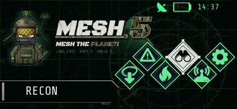

# PagerMeshTheme – MESH.5 theme for the [WiFi Pineapple Pager](https://hak5.org/products/wifi-pineapple-pager)

A community theme and ringtones for the Hak5 WiFi Pineapple Pager by SECT0101, made to go with the [PagerMesh](https://github.com/SECT0101/PagerMesh) Meshtastic payload.

| Theme | Description |
|---|---|
| [MESH.5](themes/mesh5) | LoRa mesh theme in Meshtastic green with a hacker-movie edge: the MESH.5 wordmark, Tac-Pine as a mesh operator, a MESH THE PLANET! boot finale and [matching ringtones](ringtones/mesh5) |

## Layout

- **`themes/mesh5/`** is the installable theme. Copy the folder to `/root/themes/` on the Pager, then pick it under **Settings > Display > Theme**.
- **`art/mesh5/`** holds full-size logos and the character as transparent PNGs: the MESH.5 shield, Tac-Pine, and the MESH THE PLANET! tab, shield and patch.
- **`ringtones/mesh5/`** holds the matching Pager ringtones (RTTTL). Copy the `.rtttl` files to `/root/ringtones/` on the Pager.
- **`tools/mesh5/`** holds the scripts that build the theme.

Releases have three downloads: the theme, the ringtones and the art.

## License

The original work in this repo (artwork, ringtones and build scripts) is released under the [MIT License](LICENSE).
The theme's layout and component files are based on Hak5's `wargames` reference theme, and the small stock icons are Hak5's. Those parts stay under Hak5's own license terms.

Unofficial community theme. Not affiliated with Hak5 LLC or Meshtastic LLC.
